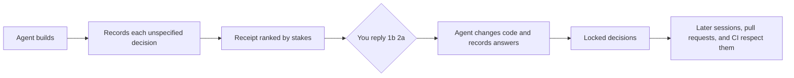

# Guesswork

**Review the decisions, not the diff.**

[](https://github.com/curlymolelabs/design-thinking-skill/actions/workflows/verify.yml)
[](LICENSE)

Your coding agent makes dozens of product decisions you never asked for: how long a session lasts, who can invite whom, whether a delete can be undone, when a trial starts charging. Those decisions hide inside diffs nobody reads, and they cause the bugs that cost money, data, and trust.

Guesswork makes the agent keep receipts. It records every decision it made without instructions, ranks them by what it costs if the guess is wrong, and ends the turn with a receipt you can answer in one line:

```text
Guesswork · 5 decisions need you (2 high stakes)

1. Deleting a workspace erases it immediately with no restore (high stakes · data · hard to undo)
   - a Keep as built
   - b 30-day restore window
   - c Require typing the workspace name to confirm
2. CSV exports include every member's email address (high stakes · privacy)
   - a Keep as built
   - b Only admins can export email addresses
   - c Leave email addresses out of exports
3. Workspace names must be unique across the whole product (medium stakes · ux · hard to undo)
   - a Keep as built
   - b Names only need to be unique per owner

Reply with your picks, like `1b 2a 3a`. `all a` keeps everything as built.
```

You reply `1b 2c 3b`. The agent changes the code, records your answers, and every later session, pull request, and CI run respects them.


## It closes the loop that code review misses

- **Receipts.** The agent records each unspecified decision as it works and ends the turn with the risky ones. Low-stakes guesses are counted, not shown.
- **One-line answers.** Replies like `1b 2a`, `all a`, or `2: restore for 14 days` become code changes and permanent records.
- **Decision memory.** In Claude Code, locked decisions load at session start and survive compaction. Editing a file that implements one reminds the agent that the owner chose it.
- **A guardrail against forgetting.** Once per turn, a stop hook asks the agent to record guesses when code changed and nothing was recorded, or to show decisions it recorded but never showed you.
- **Audit an existing app.** `/guesswork:audit` finds the decisions already hidden in your codebase, such as session lengths, deletion rules, export contents, and plan limits.
- **Pull request review.** A GitHub Action summarizes the decisions in a pull request and can block merging while high-stakes guesses are open.
- **Evidence when opinions are not enough.** When an answer depends on what users will do, the bundled [Design Thinking skill](docs/design-thinking.md) designs the smallest credible test.

## Install it in under a minute

### Claude Code gets the full loop

```text
/plugin marketplace add curlymolelabs/design-thinking-skill
/plugin install guesswork@curlymolelabs
```

On Claude Code 2.1.275 or later, one step also works:

```text
/plugin install guesswork --marketplace curlymolelabs/design-thinking-skill
```

Then build something, or run `/guesswork:audit` in an existing project. To skip permission prompts for the CLI, allow `Bash(guesswork:*)`.

### Codex, Cursor, Gemini CLI, OpenCode, and other Agent Skills clients

```bash
npx skills add https://github.com/curlymolelabs/design-thinking-skill --skill guesswork
python3 <skill folder>/scripts/guesswork.py init --agents-md
```

`init --agents-md` adds a short convention to `AGENTS.md`, which most agents read on every task. These clients get receipts and memory through the skill but not the hooks. See [the client guide](guesswork/references/clients.md).

### The CLI on its own

```bash
pipx install git+https://github.com/curlymolelabs/design-thinking-skill
uvx --from git+https://github.com/curlymolelabs/design-thinking-skill guesswork status
```

The CLI is one Python file with no dependencies. It needs Python 3.9 or newer.

## How the loop works



Agents are told to guess the safe way when they must guess: soft delete over hard delete, private over public, opt-in over opt-out, a reminder before any charge. They ask before building only when a decision is high stakes and expensive to reverse.

## The ledger is plain files in your repository

```text
.guesswork/
|-- config.json
`-- guesses/
    |-- g-workspace-delete-permanent.json
    `-- g-trial-converts-silently.json
```

Each guess is one JSON file with the decision in plain language, why it was made, its category and stakes, whether it can be undone, the files that implement it, the alternatives, and the owner's answer. One file per guess keeps parallel agents and branches from colliding. Commit the folder with the code it describes. See [the ledger format](guesswork/references/ledger-format.md).

Agents are told never to write secrets, credentials, or personal data into the ledger. In a public repository, the ledger is public too.

## Commands

| Command | What it does |
|---|---|
| `guesswork log` | Record guesses from flags or a JSON batch on standard input |
| `guesswork receipt` | Show the open decisions that need you, numbered for one-line replies |
| `guesswork decide 1b 2a` | Record answers to the latest receipt, or `g-id=b`, or `--custom "..."` |
| `guesswork context <files>` | Show the decisions that cover some files |
| `guesswork scan` | List code lines that often hide product decisions |
| `guesswork report` | Write the HTML report to `.guesswork/report.html` |
| `guesswork pr --base origin/main` | Summarize the decisions on a branch in Markdown |
| `guesswork check --fail-on high` | Exit with an error while open guesses reach a stakes level |
| `guesswork test <id> --plan "..."` | Mark a guess that needs evidence before anyone decides |
| `guesswork status` | One-line summary, also usable in a status line |

## Review decisions in pull requests

```yaml
name: Guesswork
on: pull_request
permissions:
  contents: read
  pull-requests: write
jobs:
  decisions:
    runs-on: ubuntu-latest
    steps:
      - uses: actions/checkout@v7
        with:
          fetch-depth: 0
      - uses: curlymolelabs/design-thinking-skill@main
        with:
          fail-on: high
          comment: "true"
```

The action writes the summary to the job summary, keeps one pull request comment up to date, and fails while the pull request adds open guesses at or above `fail-on`. Use `fail-on: never` for report-only mode. Pin the action to a release tag once one exists.

## How it differs from rules files and decision logs

- **`CLAUDE.md` and `AGENTS.md`** hold rules you write before the work. Guesswork captures the decisions the agent made during the work that you never anticipated.
- **Decision logs and ADRs** record what your team decided. Guesswork records what the agent decided for you, then asks you.
- **Code review** reads the diff. Guesswork reads the decisions, so you can review a two-thousand-line change in five answers.

## What is proven so far

| Question | Current answer |
|---|---|
| Do the CLI, hooks, receipts, pull request summaries, and report behave as specified? | Yes, covered by unit tests on Linux and Windows in CI |
| Does the Claude Code plugin pass Claude Code's own validator? | Yes, `claude plugin validate` passes for the plugin and the marketplace |
| Do agents reliably record the decisions they make? | Not measured yet |
| Do owners answer receipts and keep using them? | Not measured yet |

This repository uses Guesswork on itself. Its [`.guesswork/`](.guesswork/README.md) folder holds the real decisions made while building Guesswork, and they stay open until the owner answers them. [PROOF.md](PROOF.md) describes the evidence bar for the behavior claims.

## Design Thinking is the companion skill

The original skill in this repository, Design Thinking, helps agents turn uncertain product ideas into decisions backed by evidence. Guesswork hands off to it when an owner's preference cannot settle a guess. Read [the Design Thinking guide](docs/design-thinking.md).

## Contribute

Hook adapters for Cursor, Codex, Gemini CLI, and OpenCode are the most useful contributions right now, followed by scan rules for more frameworks. Read [the contribution guide](CONTRIBUTING.md). Report vulnerabilities through [private security reporting](SECURITY.md).

## License

MIT. See [LICENSE](LICENSE).
