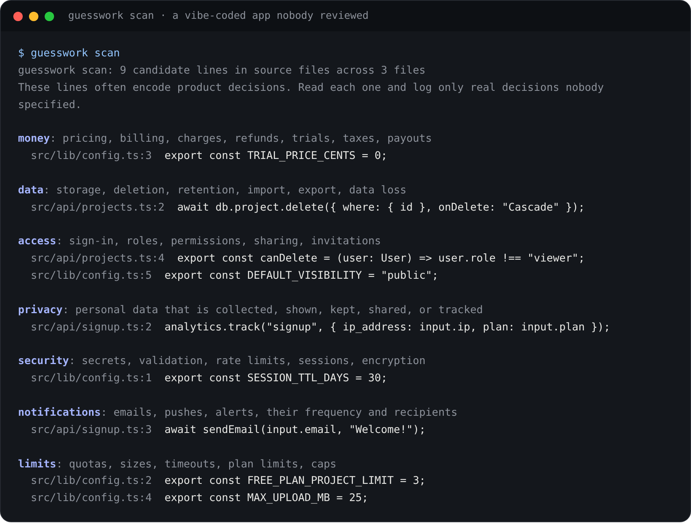
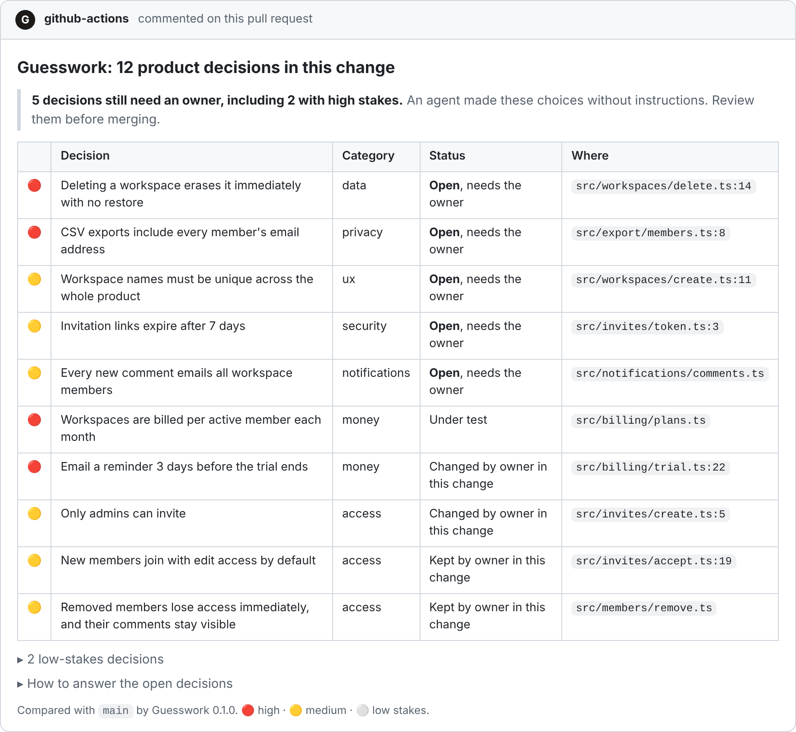
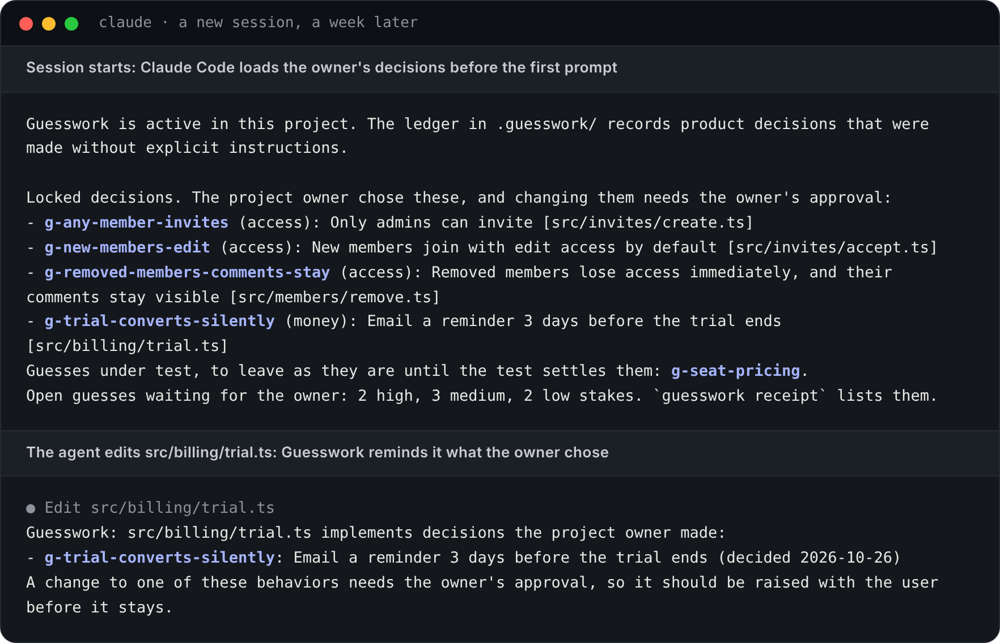
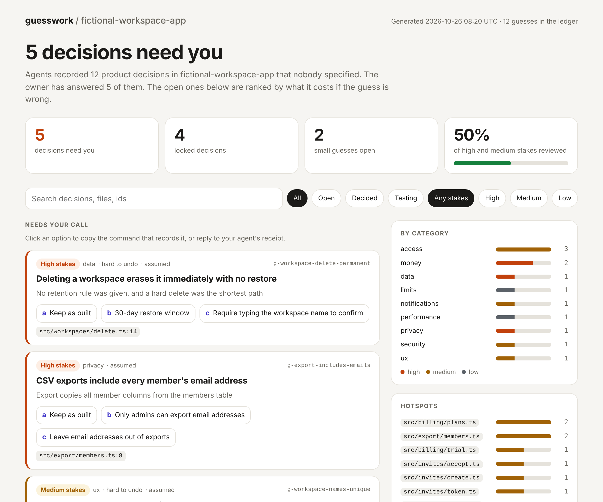

<div align="center">

# Guesswork

**Review the decisions, not the diff.**

Your coding agent makes dozens of product decisions you never asked for.<br>
Guesswork shows you the risky ones, and you answer them in one line.

[](https://github.com/curlymolelabs/guesswork/actions/workflows/verify.yml)
[](LICENSE)
[](#install-it)
[](#install-it)
[](#install-it)



</div>

## The problem nobody reviews

You asked for "team workspaces with invites and a free trial". Your agent shipped it in four minutes, and along the way it decided:

- deleting a workspace erases it forever;
- the trial charges the card on day 14 without a reminder;
- every CSV export includes every member's email address;
- any member can invite anyone.

You didn't choose any of that. It's buried in 2,000 lines of diff, and nobody will read it until a customer emails support. **The expensive bugs in agent-written code aren't syntax errors. They're decisions.**

Guesswork makes your agent keep receipts:

1. **It records every guess.** Each product decision made without instructions is logged in plain English, with why it was made and what else it could have been.
2. **It ranks them by stakes.** Money, data, access, and privacy come first. Wording and layout are only counted.
3. **You answer in one line.** Reply `1b 2c 3b`. The agent changes the code and records your answers.
4. **It never forgets.** Your answers become locked decisions that every later session, pull request, and CI run respects.

## Try it in 10 seconds

No project, no agent, no setup. This creates a fictional app with real guesses, a receipt to answer, and an HTML report:

```bash
uvx guesswork demo --open
```

Prefer pipx? `pipx run guesswork demo`. Both need Python 3.9 or newer.

## See it work

### 1. Vibe coding a feature

You ask for a feature and keep working. At the end of the turn, the agent hands you the receipt from the animation above: the decisions with real stakes, numbered, each with alternatives. Low-stakes guesses such as page sizes are recorded but only counted, so the receipt stays short.

Reply `1b 2c 3b`, `all a` to keep everything as built, or `2: something else` in your own words.

### 2. Auditing an app you already built

Run `/guesswork:audit` in an existing project. The agent scans for the lines where products usually hide decisions, reads the flows behind them, and turns what it finds into a receipt.



### 3. Reviewing a pull request

The GitHub Action adds the decisions to every pull request, so reviewers read five decisions instead of two thousand lines. It can block merging while high-stakes guesses are still open.



### 4. Remembering across sessions

A week later, a new session starts already knowing what you decided. When the agent edits a file that implements one of your decisions, Guesswork reminds it before your choice gets quietly undone.



### 5. Seeing everything at once

`guesswork report` writes a dashboard of every decision: what needs you, what's locked, which files hold the most guesses. Click an option to copy the command that records it.



### 6. Testing what you can't just decide

Some guesses are about how users will behave, such as "will teams pay per seat?". Your opinion can't settle those. Reply `3 test` and the bundled [Design Thinking skill](docs/design-thinking.md) designs the smallest test that can.

## Install it

### Claude Code: the full experience

```text
/plugin marketplace add curlymolelabs/guesswork
/plugin install guesswork@curlymolelabs
```

On Claude Code 2.1.275 or later, one step also works: `/plugin install guesswork --marketplace curlymolelabs/guesswork`.

Then build something, or run `/guesswork:audit`. To skip permission prompts for the CLI, allow `Bash(guesswork:*)`.

### Codex, Cursor, Gemini CLI, OpenCode, and other Agent Skills clients

```bash
npx skills add https://github.com/curlymolelabs/guesswork --skill guesswork
python3 <skill folder>/scripts/guesswork.py init --agents-md
```

These clients get receipts and memory through the skill and `AGENTS.md`, but not the hooks yet. Hook adapters are [open issues](https://github.com/curlymolelabs/guesswork/issues) if you want to help. See [the client guide](guesswork/references/clients.md).

### The CLI on its own

```bash
pipx install guesswork
```

One Python file, no dependencies, Python 3.9 or newer.

## How it stays out of your way

- **It guesses safely.** When the agent must guess, it picks the option that's cheapest to undo: soft delete, private by default, opt-in, a reminder before any charge.
- **It asks first only when it matters.** The agent stops to ask only when a decision is high stakes and expensive to reverse, such as a payment flow or a data model.
- **It keeps receipts short.** At most five decisions, ranked by stakes. Everything else is a count.
- **It nudges at most once.** In Claude Code, the end-of-turn check reminds the agent once per turn, and only when code changed and nothing was recorded. You can change that in `.guesswork/config.json`.

## The ledger is plain files in your repository

```text
.guesswork/
|-- config.json
`-- guesses/
    |-- g-workspace-delete-permanent.json
    `-- g-trial-converts-silently.json
```

Each guess is one JSON file: the decision, why it was made, its category and stakes, whether it can be undone, the files that implement it, the alternatives, and your answer. One file per guess keeps parallel agents and branches from colliding. Commit the folder with your code, or gitignore it to keep it private. See [the ledger format](guesswork/references/ledger-format.md).

Agents are told never to write secrets, credentials, or personal data into the ledger.

## Commands

| Command | What it does |
|---|---|
| `guesswork demo` | Create a fictional project to try everything in seconds |
| `guesswork log` | Record guesses from flags or a JSON batch on standard input |
| `guesswork receipt` | Show the open decisions that need you, numbered for one-line replies |
| `guesswork decide 1b 2a` | Record answers to the latest receipt, or `g-id=b`, or `--custom "..."` |
| `guesswork context <files>` | Show the decisions that cover some files |
| `guesswork scan` | List code lines that often hide product decisions |
| `guesswork report` | Write the HTML report to `.guesswork/report.html` |
| `guesswork pr --base origin/main` | Summarize the decisions on a branch in Markdown |
| `guesswork check --fail-on high` | Exit with an error while open guesses reach a stakes level |
| `guesswork test <id> --plan "..."` | Mark a guess that needs evidence before anyone decides |
| `guesswork status` | One-line summary, also usable in a status line |

## Review decisions in pull requests

```yaml
name: Guesswork
on: pull_request
permissions:
  contents: read
  pull-requests: write
jobs:
  decisions:
    runs-on: ubuntu-latest
    steps:
      - uses: actions/checkout@v7
        with:
          fetch-depth: 0
      - uses: curlymolelabs/guesswork@v3.0.0
        with:
          comment: "true"
```

By default the action only reports. Add `fail-on: high` to block merging while a pull request adds open high-stakes guesses.

## How it differs from rules files and decision logs

- **`CLAUDE.md` and `AGENTS.md`** hold rules you write before the work. Guesswork captures the decisions the agent made during the work, the ones you never anticipated.
- **Decision logs and ADRs** record what your team decided. Guesswork records what the agent decided for you, then asks you.
- **Code review** reads the diff. Guesswork reads the decisions.

## What is proven so far

| Question | Current answer |
|---|---|
| Do the CLI, hooks, receipts, pull request summaries, and report behave as specified? | Yes, covered by unit tests that pass on Linux and Windows in CI |
| Does the Claude Code plugin pass Claude Code's own validator? | Yes, for both the plugin and the marketplace |
| Do agents reliably record the decisions they make? | Not measured yet |
| Do owners answer receipts and keep using them? | Not measured yet |

This repository uses Guesswork on itself. Its [`.guesswork/`](.guesswork/README.md) folder holds the real decisions made while building it, and how each one was settled. [PROOF.md](PROOF.md) describes the evidence bar for the behavior claims. The screenshots come from real CLI output on the [fictional example app](examples/fictional-workspace-app/README.md).

## Contribute

Hook adapters for Cursor, Codex, and Gemini CLI, plus scan rules for more frameworks, are open as [good first issues](https://github.com/curlymolelabs/guesswork/issues). Read [the contribution guide](CONTRIBUTING.md). Report vulnerabilities through [private security reporting](SECURITY.md).

## License

MIT. See [LICENSE](LICENSE).
