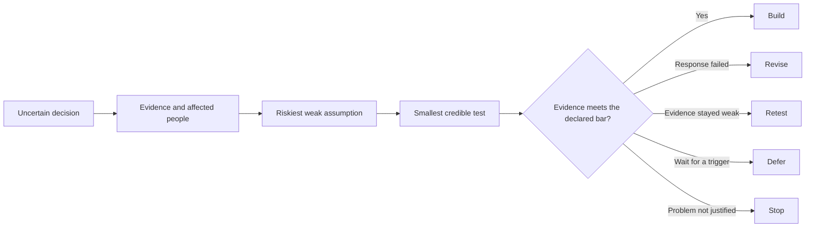

# Design Thinking for AI Agents

Design Thinking is the companion skill to [Guesswork](../README.md). Guesswork records the product decisions an agent made without instructions. Design Thinking takes over when a decision depends on evidence about real people, such as demand, willingness to pay, or comprehension, and an owner's preference cannot settle it.

[](https://github.com/curlymolelabs/guesswork/actions/workflows/verify.yml)
[](../LICENSE)

This skill helps AI agents turn uncertain product, service, workflow, policy, and experience ideas into decisions supported by evidence.

It helps an agent decide what deserves to be built, which assumption should be tested first, and when to build, revise, retest, defer, or stop.



## This skill changes product decisions, not just workshop output

The skill starts with the decision, affected people, current evidence, cost of error, and reversibility. It does not force every request through a five-stage workshop.

It gives agents concrete rules for:

- separating observation, first-hand reports, external evidence, inference, and assumption;
- choosing research or prototyping methods from the uncertainty;
- raising the evidence bar for money, identity, privacy, safety, public defaults, regulation, and costly foundations;
- generating materially different responses, including service, policy, operational, and no-build options;
- building disposable thin slices when real interaction can answer the question faster;
- preserving evidence, rejected options, remaining risk, and the next decision for later agents.

## Seven modes cover the useful entry points

| Mode | Use it when | Result |
|---|---|---|
| `frame` | The user or problem remains unclear | Known evidence, affected user, desired progress, and a clear problem statement |
| `discover` | More user or context evidence is needed | Research question, method, source plan, synthesis, limits |
| `ideate` | The team needs distinct responses | Options that work in different ways, with a clear comparison |
| `prototype` | One uncertainty needs a credible test | Prototype, prediction, task, signals, threshold, and stop rule |
| `learn` | Findings need interpretation | Evidence synthesis, contradictions, changed assumptions |
| `decide` | Investment needs a clear choice | Build, revise, retest, defer, or stop decision |
| `cycle` | The request spans several uncertain steps | The shortest connected path to a decision |

## Install it in Agent Skills clients

From a cloned repository, the simplest installer is:

```bash
npx skills add https://github.com/curlymolelabs/guesswork --skill design-thinking
```

You can also copy the complete `design-thinking` folder into a client skill directory.

Installation paths are included for Codex, Claude Code, Cursor, OpenCode, Grok Build, OpenClaw, Hermes Agent, DeepSeek Harness, ZCode, Gemini CLI, Google Antigravity, Pi, Orca ADE, and ChatGPT.

Grok Bot uses product-managed saved skills instead of direct GitHub package imports. The repository includes a compact adapter for that client.

See [the client compatibility guide](../COMPATIBILITY.md) for exact commands, support levels, and limitations.

ChatGPT users with Skills access can upload the skill folder or a zip from the Skills interface. Client support and account access can change, so check [the compatibility guide](../COMPATIBILITY.md) before installation.

The core instructions do not depend on one client's tool names.

## Invoke it with a real decision

```text
Use $design-thinking to decide who this product is for, which problem is supported by evidence, and the fastest credible test.
```

```text
Use $design-thinking in discover mode. Turn these interview notes into findings without treating anecdotes as market percentages.
```

```text
Use $design-thinking to compare a software response, a service response, and keeping the current process.
```

```text
Use $design-thinking to choose whether we should build, revise, retest, defer, or stop this feature.
```

The skill can also activate automatically when a compatible client matches the request to its description.

[The fictional repair-cooperative example](../examples/fictional-repair-handoff-decision-brief.md) shows how the skill compares software, service, policy, and no-build responses without treating assumptions as research.

## The package loads detail only when needed

```text
design-thinking/
|-- SKILL.md
|-- agents/openai.yaml
|-- assets/decision-record-template.json
|-- references/
|   |-- agentic-product-development.md
|   |-- decision-output-guide.md
|   |-- evidence-and-decisions.md
|   |-- ideation-and-facilitation.md
|   |-- methods.md
|   `-- research-and-testing.md
`-- scripts/check_decision_record.py
```

`SKILL.md` stays short. Detailed methods remain in focused guides that agents read only when the task calls for them.

## Structured records keep later agents from guessing

Substantial decisions can use the JSON template:

```bash
python design-thinking/scripts/check_decision_record.py path/to/record.json --mode draft
python design-thinking/scripts/check_decision_record.py path/to/record.json --mode decision
```

The validator uses Python's standard library. It checks identifiers, dates, evidence labels, references between records, risk levels, option count, deferred revisit triggers, and the evidence bar for build decisions.

Version 2.0 changes the decision-record structure. See [CHANGELOG.md](../CHANGELOG.md) before migrating older records.

## Checks cover package structure and agent behavior

Run the repository checks with:

```bash
python -m unittest discover -s tests -v
python design-thinking/scripts/check_decision_record.py design-thinking/assets/decision-record-template.json --mode draft
```

[EVALUATION.md](../EVALUATION.md) defines a 24-case paired test with repeated trials and blind review. [PROOF.md](../PROOF.md) states what the repository proves today and the evidence required before claiming the skill improves agent decisions.

The project does not treat passing package checks as proof of better model behavior.

## Contributions start with a reproducible failure

[The contribution guide](../CONTRIBUTING.md) explains how to report a cross-client failure without exposing private prompts or user data. Use the compatibility issue template when a client stops discovering or invoking the skill.

Report vulnerabilities and private data exposure through [GitHub's private security reporting](../SECURITY.md), not a public issue.

## License

MIT. See [LICENSE](../LICENSE).
